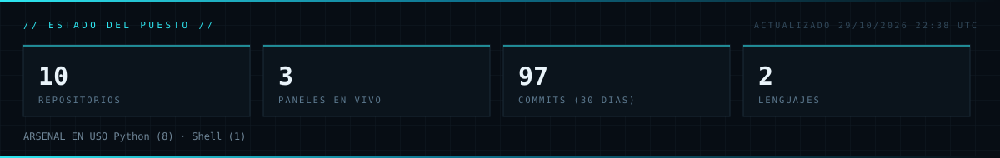

<p align="center">
  
</p>

<p align="center">
  
</p>

<p align="center">
  <a href="https://carlosvillalbalagos.com"></a>
  <a href="https://cti.carlosvillalbalagos.com"></a>
  <a href="https://dfir.carlosvillalbalagos.com"></a>
  <a href="https://box.carlosvillalbalagos.com"></a>
  <a href="https://linkedin.com/in/carlos-villalba-lagos"></a>
  <a href="mailto:contact@carlosvillalbalagos.com"></a>
</p>

<p align="center">
  
  
</p>

## `00 // FICHA DE IDENTIFICACIÓN`

```yaml
title: Tecnico de ciberseguridad (SIEM y automatizacion) con perfil DFIR e incident response
id: ch4rl13-2026
status: operativo
description: |
    Detecta a un analista de SOC, construye lo mismo que hace dentro:
    triage forense con cadena de custodia,
    detecciones con su prueba de ataque asignada,
    respuesta automatica que sabe cuando no actuar
    e infraestructura.
references:
    - https://carlosvillalbalagos.com
    - https://cti.carlosvillalbalagos.com
    - https://dfir.carlosvillalbalagos.com
    - https://box.carlosvillalbalagos.com
logsource:
    product: soc
    service: operativo
    category: respuesta_a_incidentes
detection:
    selection_rol:
        funcion:
            - administracion de SIEM (Splunk) e ingesta de logs
            - triaje y escalado de alertas
            - investigacion y analisis de causa raiz
            - ingenieria de deteccion
            - automatizacion de la respuesta (SOAR)
            - triage forense y cadena de custodia
    selection_prueba:
        operaciones_en_produccion: 3
        repositorios_publicos: 10
    filter_ruido:
        proyecto: teoria & practica
    condition: selection_rol and selection_prueba and not filter_ruido
falsepositives:
    - Perfiles que enumeran herramientas sin nada desplegado detras
level: high
```

## `01 // LO QUE CONSTRUYO Y DÓNDE ESTÁ LA PRUEBA`

Cada afirmación tiene un repositorio detrás. Si algo de aquí no se sostiene al abrirlo, abre un issue.

| Capacidad | Dónde está la prueba |
|---|---|
| **Detection as code** — 127 reglas Sigma mapeadas a ATT&CK y a pruebas de Atomic Red Team, convertidas a Splunk, Sentinel, Wazuh y Elastic, con mapeo Zero Trust y normativo | [DetectionLab](https://github.com/BlueShield-Ch4rl13/DetectionLab) |
| **Respuesta automática multi-SIEM y multi-SOAR** — los playbooks ejecutados con una política escrita en código: qué se contiene solo y qué espera a una persona | [ResponseLab](https://github.com/BlueShield-Ch4rl13/ResponseLab) |
| **Triage forense multiplataforma** con cadena de custodia y veredicto razonado | [FtriageDFIR](https://github.com/BlueShield-Ch4rl13/FtriageDFIR) · [panel en vivo](https://dfir.carlosvillalbalagos.com) |
| **Despliegue y ajuste de SIEM** — Wazuh, Suricata y detección en kernel; Splunk con ingesta, índices y reglas como código | [Infra-SocAnalyst](https://github.com/BlueShield-Ch4rl13/Infra-SocAnalyst) · [SplunkLab](https://github.com/BlueShield-Ch4rl13/SplunkLab) |
| **Inteligencia de amenazas automatizada**: fallos de seguridad que van saliendo (26 fuentes), CVE de la semana priorizados por explotación real, sistemas en riesgo y lenguajes comprometidos | [ScriptNewsCTI](https://github.com/BlueShield-Ch4rl13/ScriptNewsCTI) · [panel en vivo](https://cti.carlosvillalbalagos.com) |
| **Análisis de malware** estático y dinámico (CAPEv2 propio), configuración de familias, cruce con la inteligencia y exportación a STIX 2.1 y MISP | [Malpipe](https://github.com/BlueShield-Ch4rl13/Malpipe) · [analizar en el navegador](https://box.carlosvillalbalagos.com) |
| **Automatización de respuesta** — SOAR con TheHive, MISP y Shuffle; exportada también a Splunk SOAR, Cortex XSOAR, n8n y Sentinel | [Infra-SocAnalyst](https://github.com/BlueShield-Ch4rl13/Infra-SocAnalyst) · [ResponseLab](https://github.com/BlueShield-Ch4rl13/ResponseLab) |

## `02 // OPERACIONES`

 **NEWS CTI** &nbsp; <br>
Panel de ciberamenazas que se responde solo. Prioriza **por explotación activa, no por CVSS teórico**: un 7.5 que ya está en el catálogo KEV pesa más que un 9.8 sin exploit conocido. Cada 3 horas recoge **los fallos de seguridad que van saliendo** (avisos de 26 fuentes: INCIBE-CERT, CISA, CERT-EU, Microsoft, Cisco, Fortinet, Chrome, ZDI…, cruzados con KEV y EPSS para marcar lo que ya se explota, lo de día cero y lo que sale sin parche), ordena los CVE de la semana (NVD) por explotación real (KEV, SSVC de CISA, EPSS, Exploit-DB), dice **qué sistemas están en riesgo** (Windows, Linux, red y VPN, routers, nube, IA…) y **si un lenguaje está comprometido**: el propio intérprete explotado o paquetes maliciosos en npm, PyPI, Maven y compañía. Sus indicadores alimentan cada decisión de ResponseLab.<br>
     &nbsp; `26 fuentes de avisos` `+3.000 CVE/semana priorizados` `~2.000 IoCs por refresco` `refresco 3 h`<br>
▸ [**abrir panel**](https://cti.carlosvillalbalagos.com) &nbsp; ▸ [código](https://github.com/BlueShield-Ch4rl13/ScriptNewsCTI)

 **FTRIAGE DFIR** &nbsp; <br>
Triage forense sobre tres sistemas. Recolecta en el **orden de volatilidad de la RFC 3227**, hashea cada artefacto en la adquisición y cierra con un veredicto razonado: comprometido, sospechoso o sin indicadores. Los agentes de ResponseLab lo lanzan solos cuando un equipo se contiene.<br>
    &nbsp; `cadena de custodia` `ATT&CK`<br>
▸ [**abrir panel**](https://dfir.carlosvillalbalagos.com) &nbsp; ▸ [código](https://github.com/BlueShield-Ch4rl13/FtriageDFIR)

 **MALPIPE** &nbsp; <br>
Análisis de malware estático y dinámico. La muestra se detona en un **CAPEv2 propio** en una VLAN aislada (o en tria.ge), nunca en la máquina del analista; saca la configuración de **Cobalt Strike, Remcos y njRAT** (el C2, la campaña), cruza cada indicador con News CTI y exporta a **STIX 2.1 y MISP**. Su portal corre entero en el navegador (Python y YARA-X en WebAssembly): cualquiera comprueba un fichero sin subirlo a ningún sitio. Su veredicto, enviado a ResponseLab, propone bloquear el hash en toda la flota.<br>
     &nbsp; `la muestra no sale del navegador` `configuración de familias` `ATT&CK`<br>
▸ [**analizar un fichero**](https://box.carlosvillalbalagos.com) &nbsp; ▸ [código](https://github.com/BlueShield-Ch4rl13/Malpipe)

 **INFRA-SOCANALYST** &nbsp; <br>
SOC completo con detección en **tres capas**: Suricata ve el C2 aunque el endpoint mienta, Wazuh ve integridad y configuración, Falco y Tetragon ven las llamadas al sistema dentro de contenedores. Evadir una es viable; evadir las tres, caro.<br>
      <br>
▸ [código](https://github.com/BlueShield-Ch4rl13/Infra-SocAnalyst)

 **DETECTIONLAB** &nbsp; <br>
Detection engineering y purple team. Reglas **Sigma** generadas para **cuatro SIEM** desde una sola fuente, cada una con su técnica ATT&CK y su prueba de Atomic Red Team asignada; el estado real de cada una (probada, detectada o pendiente) está en `purple/atomic-map.md`. Una regla que nunca se ha probado contra el ataque que dice detectar no es cobertura, es una hipótesis, y el mapa lo dice regla a regla. Incluye el *Detection Pack* que estaba planificado: mapeo Zero Trust (NIST 800-207, CISA ZTMM 2.0) y normativo (ENS, NIS2, DORA, RGPD, ISO 27001/22301), y los 15 playbooks de respuesta que ejecuta ResponseLab.<br>
       &nbsp; `127 reglas Sigma` `4 SIEM` `15 playbooks`<br>
▸ [código](https://github.com/BlueShield-Ch4rl13/DetectionLab)

 **SPLUNKLAB** &nbsp; <br>
Splunk desde cero en Docker Compose, con ficheros versionados en vez de clics: ingesta por **HEC y Universal Forwarder**, índice y parseo en `.conf`, **21 reglas** de detección con ventana, umbral y silenciado, y los datos de vuelta a JSON, CSV y un dashboard propio por la **API REST**.<br>
   &nbsp; `HEC 8088` `21 detecciones` `API REST`<br>
▸ [código](https://github.com/BlueShield-Ch4rl13/SplunkLab)

 **RESPONSELAB** &nbsp; <br>
Respuesta a incidentes como código, multi-SIEM y multi-SOAR. Ejecuta los playbooks de DetectionLab con una política escrita en código: una acción solo va sola si su **radio es estrecho y se puede deshacer**. Nada que afecte a una cuenta o a toda la organización se ejecuta sin una persona, y un controlador de dominio o un HMI de planta no se tocan solos. Motor multi-cliente (MSSP), la misma lógica exportada a cinco SOAR y diez ataques simulados con alertas reales que el CI repite en cada cambio. Listo para el servidor de `OP-08`: un script genera los secretos y la configuración de Wazuh, Splunk y pfSense, y el CI levanta el despliegue con TLS, lo comprueba, hace una copia y la restaura en cada cambio.<br>
       &nbsp; `239 reglas` `54 acciones` `1205 pruebas` `RGPD · NIS2 · DORA`<br>
▸ [código](https://github.com/BlueShield-Ch4rl13/ResponseLab)

```
   OP-01 ──►  OP-05 ──►  OP-04 · OP-06 ──►  OP-07 ──►  OP-02 · OP-03
   qué pasa   reglas     los SIEM           responde   investiga equipo
   ahí fuera  mapeadas   alertan            solo       y muestra
```

## `03 // ÚLTIMOS DESPLIEGUES`

<!-- Este bloque lo reescribe scripts/generar_perfil.py cada día. No editar a mano. -->
<!-- INICIO:DESPLIEGUES -->
`29/10` **BlueShield-Ch4rl13** — Merge pull request #4 from BlueShield-Ch4rl13/ci-sin-carreras · [`0ac2dee`](https://github.com/BlueShield-Ch4rl13/BlueShield-Ch4rl13/commit/0ac2dee087ebb5b56a5deda324f19b4dce496737)<br>
`29/10` **BlueShield-Ch4rl13** — CI del perfil: sin ejecuciones simultáneas y rebase antes de publicar · [`171c634`](https://github.com/BlueShield-Ch4rl13/BlueShield-Ch4rl13/commit/171c634c8160f09f1416490f8c977e72bbd818f9)<br>
`29/10` **Malpipe** — Merge pull request #7 from BlueShield-Ch4rl13/dependabot/npm_and_yarn/portal-b6c30b6bca · [`ce8ace4`](https://github.com/BlueShield-Ch4rl13/Malpipe/commit/ce8ace4d4193493e03d3d51ab6a4137c6fa6d41b)<br>
`29/10` **Malpipe** — Merge pull request #6 from BlueShield-Ch4rl13/dependabot/github_actions/actions-58ba8771c9 · [`a94b1cd`](https://github.com/BlueShield-Ch4rl13/Malpipe/commit/a94b1cd2e98510422b2259272cbbfaecec36333c)<br>
`29/10` **Malpipe** — Merge pull request #3 from BlueShield-Ch4rl13/dependabot/pip/python-db35888ead · [`9fbb827`](https://github.com/BlueShield-Ch4rl13/Malpipe/commit/9fbb827a5b9527bffa9f5f1b88d9b0e082f3a8c5)
<!-- FIN:DESPLIEGUES -->

## `04 // PRÓXIMAS OPERACIONES`

| | Operación | Qué será | Estado |
|---|---|---|---|
| **`OP-08`** | [HomeLab](https://github.com/BlueShield-Ch4rl13/HomeLab) | Servidor propio en casa donde corren a la vez todas las operaciones, con la red segmentada por VLAN como en `OP-04`: el SOC, el atacante y las víctimas sin apagar nada, ResponseLab conteniendo de verdad y un subdominio público para ver los datos. | `EN MONTAJE` |
| **`RPT-02`** | [Informe de incidente](https://carlosvillalbalagos.com/writeups/rpt-02) | Un equipo comprometido en laboratorio, examinado con FtriageDFIR de principio a fin: metodología NIST SP 800-61, cadena de custodia, línea temporal, mapeo ATT&CK y veredicto con nivel de confianza. | `EN REDACCIÓN` |

<sub>Ya publicado: <a href="https://carlosvillalbalagos.com/writeups/rpt-01"><code>RPT-01</code>, la metodología de scoring de IoCs de News CTI</a>. Entregados desde la última revisión: el <b>panel de Malpipe</b> en <code>OP-03</code> (<a href="https://box.carlosvillalbalagos.com">box.carlosvillalbalagos.com</a>) y <code>OP-07</code>, ResponseLab, listo para el servidor. Nada de esto es teoría: todo se despliega en el servidor de <code>OP-08</code>.</sub>

## `05 // ARSENAL`

**`SIEM Y SOAR`**<br>
       

**`RESPUESTA A INCIDENTES`**<br>
     

**`FORENSE`**<br>
     

**`DETECCIÓN`**<br>
     

**`ENDPOINT Y RED`**<br>
      

**`IDENTIDAD Y CORREO`**<br>
     

**`AUTOMATIZACIÓN`**<br>
     

## `06 // ESTADO DEL PUESTO`

<p align="center">
  
</p>

<sub>Panel regenerado a diario desde la API de GitHub por <a href="./.github/workflows/actualizar-perfil.yml">una Action</a>. No muestra estrellas ni seguidores a propósito: miden popularidad, no trabajo.</sub>

---

<sub>Objetivo: <b>SOC L2/L3 o DFIR/IR</b>. Si ves algo mal hecho, abre un issue: prefiero la corrección a la estrella.</sub>
